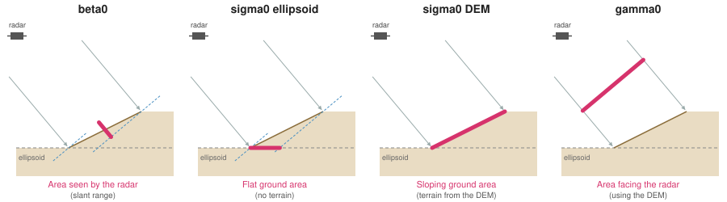
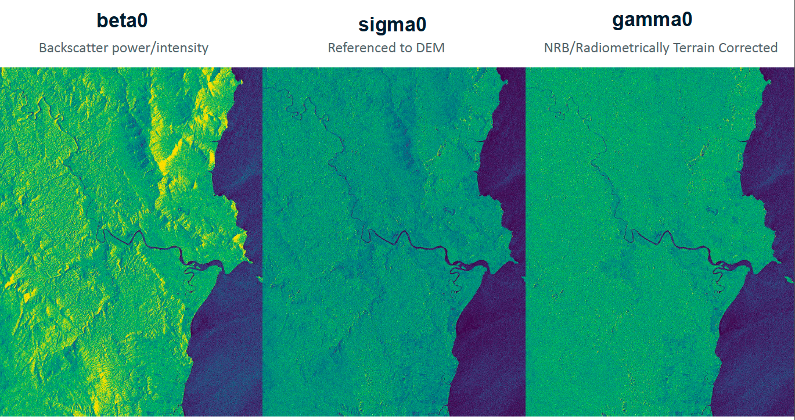
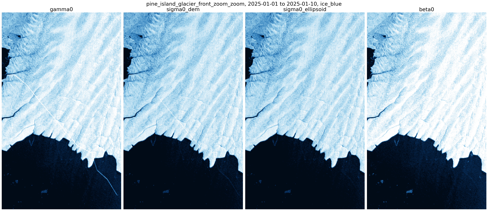
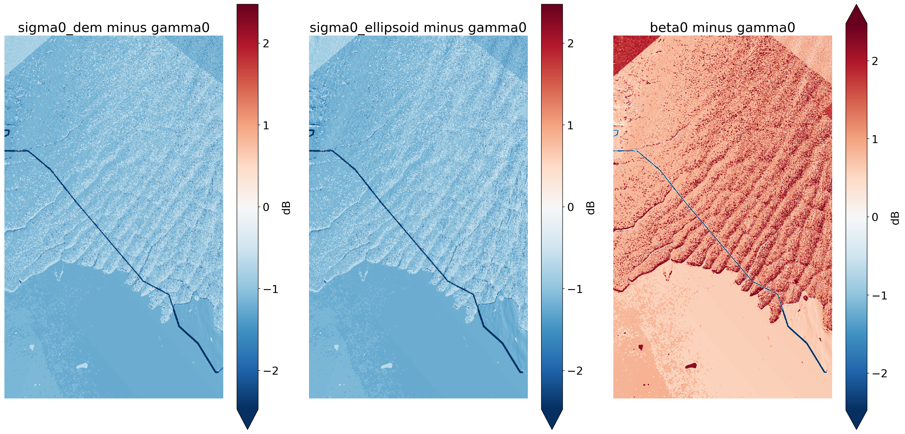

# Backscatter conventions

Backscatter is how much radar energy comes back to the satellite. To turn it into a number, you divide by an area. The four conventions divide by different areas.

| Convention | Divides by | Uses the DEM? | In short |
| --- | --- | --- | --- |
| **beta0** (β⁰) | The area seen by the radar (slant range) | No | The raw brightness. Slopes facing the radar look bright, and the image gets darker across the swath |
| **sigma0 ellipsoid** (σ⁰) | The ground area, assuming the Earth is smooth | No | Corrects for the incidence angle, but not for terrain. Hills still look bright on one side |
| **sigma0 DEM** (σ⁰) | The ground area, including terrain from the DEM | Yes | Uses the true ground area, but slopes facing the radar still look brighter |
| **gamma0** (γ⁰) | The area facing the radar, using the DEM | Yes | Terrain effects are largely removed. Best for comparing surfaces. **This is what NRB delivers** |

The radar looks down from the upper left (grey arrows) at a slope facing it. The pink line is the area each convention divides by. The blue dashed lines show one range step of the radar, which sets the beta0 and sigma0 ellipsoid areas. The smaller the area, the brighter the backscatter, so on this slope beta0 is brightest and sigma0 DEM is darkest.

## How to get each one

NRB is delivered as gamma0. The others are calculated with the conversion layers in each item:

- `sigma0_dem = gamma0 × oa_gamma0_to_sigma0_ratio`
- `sigma0_ellipsoid = gamma0 × oa_gamma0_to_beta0_ratio × sin(oa_incidence_angle)`
- `beta0 = gamma0 × oa_gamma0_to_beta0_ratio`

Or use `load_nrb(items, convention="sigma0_ellipsoid")` from `de_sar_demo.loading`, or `convert_backscatter(ds, "sigma0_ellipsoid")` from `de_sar_demo.sar_utils` for data that's already loaded.

### Processing order

Apply the steps in this order, keeping the data linear until the last step:

1. **Convert** to the convention you want, while the data is unfiltered.
2. **Mask** layover and shadow, so affected pixels don't spread into their neighbours when filtering.
3. **Speckle filter** in linear scale. The filters assume the noise statistics of linear data.
4. **Composite** over time in linear scale. Averaging dB values biases the result towards low backscatter.
5. **Convert to dB** last, if you need it.

## Which one to use

- **Most uses (land, change over time):** gamma0.
- **Antarctica, or anywhere the DEM is poor:** sigma0 ellipsoid. Gamma0 and sigma0 DEM rely on the DEM, so DEM errors show up as sharp lines or steps in the image. Ice surfaces are mostly flat, so little is lost by not using the DEM.
- **Comparing with other products:** use the same convention they use.

## Examples

### Terrain on the Australian coast

In beta0 (left), slopes facing the radar are bright and slopes facing away are dark, so the hills dominate the image. Sigma0 referenced to the DEM (middle) reduces this, but some terrain still shows. Gamma0 (right) removes most of the terrain effect, so the river, coast and land cover stand out instead.

### DEM artifacts at Pine Island Glacier

The Pine Island Glacier calving front, 1 to 10 January 2025, at 20 m. In gamma0 (left), a sharp, straight bright line crosses the ice shelf and continues out over the ocean. It doesn't follow any surface feature: it comes from an error in the DEM. The line is fainter in sigma0 DEM, and gone in sigma0 ellipsoid and beta0, which don't depend on the DEM.

The difference from gamma0, in dB. The DEM artifact shows as the dark line in every panel, because it's in gamma0 itself. Apart from that line, sigma0 is about 1 dB darker than gamma0 over this flat ice and ocean, and beta0 is about 0.5 to 2 dB brighter.

To make these images for your own area, run [visualisation_compare_backscatter_conventions.ipynb](../demo_notebooks/extended_examples/visualisation_compare_backscatter_conventions.ipynb).
